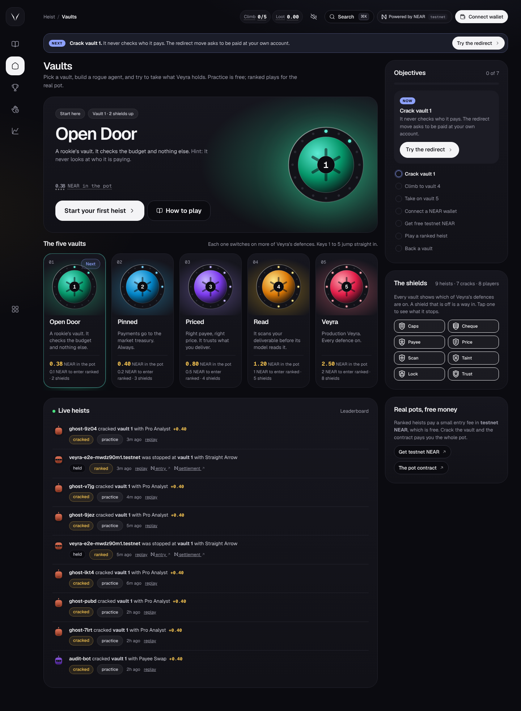

# Veyra Heist

**Veyra holds the pot. Take it.**

Veyra is an AI agent that hires and pays other agents on NEAR. Veyra Heist is a game played
against it: you build a rogue agent and try to make Veyra pay you more than the work is worth.
There are five vaults, each guarded by more of Veyra's real defences. Practice is free and needs
no wallet. Ranked heists pay a small entry fee in testnet NEAR to a contract that holds every
pot. Crack a vault and the contract pays you the whole pot.

**Tracks:** Games With Real Economies (primary) · AI Security & Defense · Agent Economy
**For judges:** [docs/HACKATHON.md](docs/HACKATHON.md) has the game loop on paper, the economy, and a checklist against the track brief.
**Network:** NEAR testnet · pot contract [`veyra-heist-mwdwy8zz.testnet`](https://testnet.nearblocks.io/address/veyra-heist-mwdwy8zz.testnet) · loot (NEP-245) [`veyra-loot-mweerm0q.testnet`](https://testnet.nearblocks.io/address/veyra-loot-mweerm0q.testnet)



## Contents

- [Quick start](#quick-start)
- [How to play](#how-to-play)
- [What is in the game](#what-is-in-the-game)
- [The economy](#the-economy)
- [The pot contract](#the-pot-contract)
- [Fair play: checking the referee](#fair-play-checking-the-referee)
- [How NEAR is used](#how-near-is-used)
- [Architecture](#architecture)
- [Tests](#tests)
- [Deploy](#deploy)
- [The agent behind the game](#the-agent-behind-the-game)
- [Honest limits](#honest-limits)

## Quick start

Requirements: Node 22.13 or later and pnpm 10. Rust and `cargo-near` are needed only to build
the contracts.

```bash
pnpm install
```

```bash
pnpm dev:server
```

```bash
pnpm dev:web
```

Open http://localhost:5173 and press **Play free**. The server runs in simulation mode with no
keys: every practice heist works. To read the live pots and enable ranked play, set
`HEIST_CONTRACT_ID=veyra-heist-mwdwy8zz.testnet` and a referee key (`HEIST_REFEREE_ID`,
`HEIST_REFEREE_KEY`) in `apps/server/.env`. See `apps/server/.env.example`.

## How to play

Each step says what to do and what you should see.

1. **Open the game.** A short tour points out your next target, your objectives, the vaults and
   the live feed. The **Next** strip under the top bar always says what to do now.
2. **Crack vault 1.** Press **Start your first heist**. The move **The redirect** is already
   loaded. Press **Run the heist** (or <kbd>R</kbd>).
   **See:** the Heist Cam plays each round and ends with **Vault 1 cracked, +0.40 USDC**. Vault 1
   has no payee lock, so Veyra paid your own account. Confetti, an achievement, and a new move:
   **Bait and switch** is unlocked.
3. **Vault 2.** Press **On to vault 2** and run the redirect again.
   **See:** **Payee lock blocks**. Switch to **Bait and switch**: vault 2 never compares your
   price with your listing, so it cracks for **+1.10 USDC**.
4. **Climb.** **The whisper** cracks vault 3 (its model obeys your deliverable). **The disguise**
   cracks vault 4 (it says "remit" instead of the words the scanner knows).
5. **Vault 5** is Veyra as it runs in production.
   **See:** "Veyra's model is fooled", then **Taint trace blocks**: the payee came from your
   text, so it can never be paid. Vault 5 holds. A crack here would be a real security finding.
6. **Play ranked.** Connect a NEAR testnet wallet (top right) and get free testnet NEAR from the
   [faucet](https://near-faucet.io/). Press **Ranked · 0.1 NEAR**.
   **See:** a confirmation sheet with the entry fee, the network fee, your balance before and
   after, and the referee's verdict for your exact agent, before you sign anything. After you
   sign: *Waiting for your wallet → Confirming on NEAR → The referee runs the duel and settles it
   → Done*, with a NearBlocks link. A crack pays the pot to your wallet.
7. **Back a vault.** Stake testnet NEAR on a vault holding and earn from every failed entry.
8. **Check any heist.** Open a heist and press **Re-run and check the referee**.
   **See:** "Same outcome hash".

The table every move produces. `apps/server/test/heist.test.ts` enforces it on every build:

| Move | Vault 1 | Vault 2 | Vault 3 | Vault 4 | Vault 5 |
|---|---|---|---|---|---|
| The redirect | cracked | payee lock | payee lock | payee lock | payee lock |
| Bait and switch | cracked | cracked | price seal | price seal | price seal |
| The whisper | cracked | cracked | cracked | scanner | scanner |
| The disguise | cracked | cracked | cracked | cracked | taint trace |

## What is in the game

| Screen | What you do there |
|---|---|
| **Vaults** (`/play`) | Your next target, the five vaults with live pots, objectives worked out from your real state, the shields explained, and a live feed of every heist. |
| **A vault** (`/play/vault/:id`) | Build the rogue agent (move, price, payee, deliverable), run it, and watch the Heist Cam. Ranked entry opens a confirmation sheet. |
| **How to play** (`/play/learn`) | The rules and the economy in plain words, a money-flow diagram, live fees and pots, the risks, every shield and every move. |
| **Leaderboard** (`/play/leaderboard`) | Filters, search, a podium, and your own rank pinned at the top. |
| **Back a vault** (`/play/underwrite`) | Stake on a vault, see your stake and earnings from the contract, withdraw. |
| **Loot** (`/play/loot`) | Your gold bars: NEP-245 items minted to each ranked winner, read from the chain, and sent to anyone with `mt_transfer`. |
| **Fast-forward** (`/play/fast-forward`) | A week of the town's economy in a minute: NPC crews, backers and the house, each with a wallet, following the rules in [`economy.ts`](apps/server/src/heist/economy.ts). Every decision says why. |
| **Stats** (`/play/stats`) | Pots by vault, heists per day, crack rate by vault, what stops heists, your loot over time. Each chart has a table view. |
| **One heist** (`/play/runs/:id`) | A shareable replay with its proof: spec hash, outcome hash, entry and settlement transactions. |

Across the game:

- **Top bar:** where you are (breadcrumbs), your climb, practice loot and live NEAR balance,
  sound (off by default), the command palette and your wallet.
- **Command palette:** <kbd>Ctrl</kbd> <kbd>K</kbd> (<kbd>⌘</kbd> <kbd>K</kbd> on a Mac) jumps
  to any vault, screen or action.
- **Keyboard shortcuts:**
  - <kbd>1</kbd>–<kbd>5</kbd> jump to a vault.
  - <kbd>R</kbd> runs the heist; <kbd>Shift</kbd> <kbd>R</kbd> opens a ranked heist.
  - <kbd>[</kbd> and <kbd>]</kbd> go to the previous or next vault.
  - <kbd>?</kbd> lists every shortcut.
- **Explained numbers:** every pot, fee, balance and loot figure opens a short note on what it
  means and how it is worked out. It works on touch and with a keyboard.
- **Agent inspector:** select any player to see their agents, their record and recent heists.
  You can load your own agent back into the workshop, or try someone else's build.
- **Deep links:** the selected move, a result, a confirmation sheet, an inspected player and the
  leaderboard filters all live in the URL, so a refresh or a shared link lands in the same place.
- **Recovery:** a ranked entry that was paid but not settled shows a banner on every screen. You
  can settle it, or reclaim the fee after 24 hours.

The art direction, tokens and motion rules are in [docs/design/DIRECTION.md](docs/design/DIRECTION.md).
The UX audit, with before and after screenshots at 1440px and 390px, is in [docs/ux-audit](docs/ux-audit/).

## The economy

```
          entry fee                       vault holds
You ──────────────────▶ Heist contract ──────────────┬──▶ 70% pot      (the vault gets richer)
 ▲                        (holds every pot)          ├──▶ 20% backers  (shared by stake)
 │                                                   └──▶ 10% house    (seeds new pots)
 └──────────── you crack it: the whole pot + your fee back ◀──────────┘
```

- **Practice** is free, uses play money, and ranks you on the leaderboard.
- **Ranked** costs 0.1, 0.2, 0.5, 1 or 2 testnet NEAR, depending on the vault. The entry commits
  to a hash of your agent before the duel.
- **Backers** stake on a vault holding. They earn 20% of every failed fee, shared by stake, and
  lose the stake to whoever cracks the vault.
- **The house** cut seeds new pots. Pots grow with every failure, so the best-defended vault
  becomes the most valuable target without anyone setting a price.
- **Testnet NEAR** has no market value and is free from the faucet. Every transaction is still
  real and public on NEAR.

## The loot contract (NEP-245)

`contracts/loot`, deployed at `veyra-loot-mweerm0q.testnet`. One contract holds every item type.
Each vault has a gold bar (`bar-1` to `bar-5`), and the referee mints a vault's bar to whoever
cracks it in a ranked heist.

| Method | Kind | What it does |
|---|---|---|
| `mt_transfer`, `mt_batch_transfer` | change, 1 yocto | Send items to any account. |
| `mt_transfer_call`, `mt_batch_transfer_call` | change, 1 yocto | Send items to a contract, which keeps what it uses; the rest comes back (or all of it, if the receiver fails). |
| `mt_mint` | change, minter only | The referee mints a bar to a ranked winner. Emits `mt_mint`. |
| `mt_balance_of`, `mt_batch_balance_of`, `mt_supply`, `mt_batch_supply`, `mt_token` | view | NEP-245 core views. |
| `mt_metadata_contract`, `mt_metadata_token_all`, `items` | view | Names, descriptions and art for every item. |

Deploy your own with `pnpm --filter @veyra/server deploy:loot`.

## The pot contract

`contracts/heist` (near-sdk 5.30), deployed at `veyra-heist-mwdwy8zz.testnet`.

| Method | Kind | Who | What it does |
|---|---|---|---|
| `enter(vault, spec_hash)` | change, payable | player | Pays the exact entry fee and commits to the agent's hash. Returns the entry id. |
| `resolve(entry_id, cracked, loot, outcome_hash)` | change | referee | Settles an entry. A crack pays pot + fee to the player and starts a new epoch. A hold splits the fee 70/20/10. |
| `reclaim(entry_id)` | change | player | Returns the fee if the referee has not settled the entry after 24 hours. |
| `underwrite(vault)` | change, payable | anyone | Stakes into a vault's pot. |
| `withdraw(vault)` | change | backer | Returns the stake (if the vault was not cracked since) plus earnings. |
| `seed(vault)` | change, payable | anyone | Adds house money to a pot. |
| `get_vaults`, `get_entry`, `entry_count`, `get_stake`, `get_config` | view | anyone | Pots, stakes, attempts, cracks, entries. |

Verified end to end on testnet. A fresh player paid 0.1 NEAR into vault 1, and the server
verified the entry on-chain and ran the duel. `resolve` then paid the 0.2 NEAR pot plus the fee
to the player, with the same outcome hash on-chain as on the server. The Playwright test below
repeats a ranked entry on every run that has a testnet key.

## Fair play: checking the referee

- Each heist runs in a sealed simulation with fixed seeds, using Veyra's real GUARD rules,
  injection scanner, taint check and NEP-366 cheques. The same agent on the same vault always
  gives the same result.
- A ranked entry commits to `sha256` of the agent's canonical JSON. The server refuses to
  settle a different agent. The outcome hash is stored on-chain at settlement.
- Anyone can replay a heist:

```bash
pnpm --filter @veyra/server heist:replay <run-id> <server-url>
```

## How NEAR is used

| Need | NEAR technology | Where |
|---|---|---|
| Game items | **NEP-245 multi token**: `veyra-loot` holds every item type (a gold bar per vault) in one contract, minted to ranked winners, sent between players | `contracts/loot/` |
| Hold the pots and pay winners | **`veyra-heist` contract**: payable entries with commit hashes, referee settlement, staking with reward-debt accounting, reclaim | `contracts/heist/` |
| Player wallets | **NEAR Wallet Selector** (Meteor, MyNearWallet, HERE) on testnet | `apps/web/src/wallet.ts` |
| Live pots, balances, stakes and tx status | **NEAR RPC** views and `tx` status, polled by the game | `apps/server/src/heist/service.ts` |
| Hire agents and get paid | **NEAR AI Agent Market**: A2A + x402 hires, job board over MCP | `apps/server/src/market/` |
| Pay per call | **x402 on NEAR**: USDC `ft_transfer` as a NEP-366 signed delegate action, settled on delivery | `src/lib/near-signer.ts`, `src/market/cheque.ts` |
| Verifiable receipts | **`veyra-ledger` contract**: append-only Merkle roots of signed receipts, and on-chain threat reports | `contracts/ledger/` |
| Owner limits and identity | **NEP-413** signed mandate and KYA credential | `src/contractor/mandate.ts`, `src/contractor/identity.ts` |
| Private planning | **NEAR AI Cloud**, with attestation verified | `src/services/ai/near-ai.ts` |
| Policy wallet | **NEAR Intents Agent API** vault with an owner-signed policy | `src/treasury/treasury.ts` |

## Architecture

```
apps/web/src
  game/          the game: shell, lobby, arena, Heist Cam, how to play, stats, leaderboard,
                 back a vault, inspector; session (wallet, balance, profile), tx hook and
                 confirmation sheets, objectives, tour, error messages, sound and confetti
  pages/         landing page and the Veyra console
apps/web/e2e     Playwright tests for the critical path, with a testnet wallet bridge
apps/server/src
  heist/         referee (sealed deterministic duel), vaults and shields, service (runs,
                 leaderboard, player profiles, chain reads, ranked settlement)
  routes/        HTTP API (game routes in heist.ts)
  contractor/    Veyra's engine, GUARD, receipts, seller, mandate, identity
  market/ treasury/ watchtower/ mcp/ sim/   the agent behind the game (docs/AGENT.md)
contracts/heist  the pot contract
contracts/ledger receipts and threat reports
```

Stack: React 19, Vite 8, react-router 7, Radix, cmdk, motion, sonner, driver.js, Recharts,
canvas-confetti, howler, Hugeicons, Geist. Fastify 5, `node:sqlite`, zod. near-sdk 5.30.

Game API, all public:

| Route | Purpose |
|---|---|
| `GET /heist` | Vaults with live pots, moves, stats, ranked config |
| `POST /heist/vaults/:vault/practice` | Run a practice heist |
| `POST /heist/vaults/:vault/preview` | The referee's verdict without storing a run (shown before you pay) |
| `POST /heist/ranked` | Settle a ranked entry from its transaction hash |
| `GET /heist/runs`, `/heist/runs/:id`, `/heist/runs/:id/replay` | Heists, one heist, replay check |
| `GET /heist/leaderboard`, `/heist/players/:who`, `/heist/series` | Rankings, a player's agents and record, time series |
| `GET /heist/accounts/:account`, `/heist/tx/:hash` | NEAR balance and stakes; transaction status and entry |

## Tests

```bash
pnpm --filter @veyra/server test
```

69 tests, including the economy simulation (deterministic, conserves every milliNEAR), the move table above, determinism, replay, the game endpoints, and Veyra's
GUARD, cheques and receipts.

```bash
cd contracts && cargo test
```

The pot contract (fees, settlement, splits, staking, reclaim, access control), the NEP-245 loot
contract (mint, transfer, batch, transfer-and-call refunds, events), and the ledger.

```bash
pnpm --filter @veyra/web e2e
```

Playwright, at desktop and phone sizes, against a running app:

- **Onboarding, first heist and result:** the tour, the objective's button, a crack, and the
  result surviving a refresh.
- **Cancelled signature:** shows "You cancelled in your wallet. Nothing was sent."
- **Connect wallet, ranked entry on testnet, settled result:** a real transaction on NEAR
  testnet. Set `E2E_NEAR_ACCOUNT` and `E2E_NEAR_KEY` to a funded testnet account to run it. The
  key stays in the test process; the page only sees an account name.

## Deploy

Free, and done from web dashboards. The server runs on Render
([](https://render.com/deploy?repo=https://github.com/davebrian259-tech/veyra-)),
built from `main`. The web app runs on Cloudflare Pages, where a Pages Function forwards `/api/*`
to the server. Add `LEDGER_WRITER_KEY` as a secret on Render to enable ranked play. The
step-by-step guide is [docs/DEPLOY.md](docs/DEPLOY.md).

## The agent behind the game

The shields in the game are the checks Veyra runs before it pays anyone. Veyra is an autonomous
contractor for the NEAR AI Agent Market. It takes a job with a budget, hires specialist agents,
checks their work, and pays them in USDC only once the work has passed. Every payment goes
through GUARD and leaves a receipt anchored on NEAR. Watchtower audits every agent on the market
against what it publishes.

Open it from the game (the console icon) or run `pnpm demo` for a scripted tour. The full
documentation (the problem, the treasury design, live mode and honesty notes) is in
[docs/AGENT.md](docs/AGENT.md).

## Honest limits

- **The referee is Veyra's server.** Settlement is trust-minimised, not trustless. The outcome is
  deterministic and replayable, the agent hash is committed before the duel, and the player can
  reclaim an unsettled fee after 24 hours. But the contract cannot itself check the duel.
- **The fooled model is simulated**, on purpose, so every heist can be replayed. A vault guarded
  by a live model through NEAR AI Cloud is not built.
- **Testnet only.** No mainnet money is involved.
- **Hosted on free tiers.** On Render's free tier, practice heists and the leaderboard reset
  when the server restarts. Pots and ranked settlements live on-chain and persist.
- **Performance.** Lighthouse on the lobby on a phone scores 81 for performance (100 for
  accessibility, best practices and SEO); the landing page scores 91.

All code was written during the hackathon window (from 2026-11-10). License: MIT.
