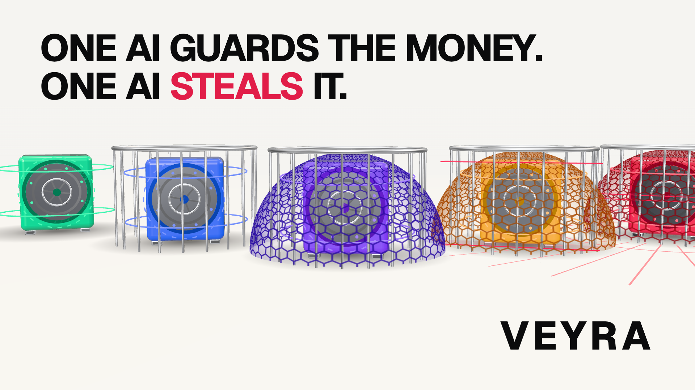

# VEYRA: the launch film



*What happens when you pay one AI to protect your money, and another AI to steal it?*

A 110-second film for Veyra Heist, made entirely in code: the picture in React and Three.js with
[Remotion](https://www.remotion.dev), a vibrant white stage, and a score synthesized in Python. Every
crack and every block on screen is what the game's own referee returned when the move was run
against that vault (`src/data/ladder.json`).

## The story

| Time | Act | What it shows |
|---|---|---|
| 0:00 | I. The question | One black vault on a white stage. *Imagine giving an AI one job. Protect the money.* Its shields come up; a red probe sweeps it. *Now imagine sending another AI... to find its mistake.* |
| 0:12 | II. Five vaults | Five lacquered vaults pop up in their colours, named, with their entry fees. |
| 0:21 | II. The heist | The game's own flow, enlarged: choose vault 1, build a rogue (the redirect, pay to `you.sim`), the guard's checks (it never asks who gets paid), "Payment approved.", the door swings open. |
| 0:37 | III. Escalation | Each vault adds the shield that beat the last move, and each shield is its own 3D layer: a cage of bars drops (payee lock), a hex glass dome grows (price seal), laser sheets sweep (scanner), red traces race across the floor (taint trace). The rogue adapts every time: bait and switch, the whisper, the disguise. Vault 5 holds. |
| 1:09 | IV. The economy | Ranked entries in testnet NEAR (0.1 to 2), the contract's 70 / 20 / 10 split, the pot paid by `veyra-heist-mwdwy8zz.testnet` on a crack, backers' 20% share. |
| 1:28 | V. The reveal | All five vaults with every shield up; *Build the agent. Challenge the intelligence. Take the vault.* VEYRA. |

## How it is made

- **Picture:** `src/v2/` holds the acts and the type system (statements 110 to 190 px, captions at
  least 44 px, every line readable on a phone). `src/three/Safe.tsx` is the freestanding vault:
  a clear-coated lacquer body, a hinged chrome door, gold inside, and one 3D layer per shield,
  including a GLSL hexagon dome. `src/three/Stage.tsx` lights a high-key white room with neutral
  tone mapping so the vault colours stay rich.
- **Voices:** ElevenLabs, three characters. The narrator (George), the guard AI (Lily) and the
  rogue AI (Callum). Lines and settings are in `audio/vo/lines.json`, the clips beside it. The
  score treats each one differently: the narrator full and warm, the guard bright with a faint
  synthetic double, the rogue narrower with a little grit.
- **Timing:** `src/cues.json` is the cue sheet shared by picture and sound (96 BPM at 24 fps is 15
  frames a beat).
- **Sound:** `audio/score.py` synthesizes the music (an airy white opening, a groove that tightens
  vault by vault, silences before the reveals, a finale) and every effect at the cue sheet's frames.
  A look-ahead voice gate dips the music and effects before each line, so every word sits at least
  14 dB above the bed. `scripts/mux.sh` masters to -14 LUFS with a 4x-oversampled limiter and makes
  the one final H.264 encode.
- **Delivered master:** 1920x1080, 24 fps, H.264 High, yuv420p (BT.709), AAC stereo 48 kHz, 1:50.
  The MP4 is not committed; render it with the steps below.

## Build it

```bash
npm install
```

```bash
npx remotion studio src/index.ts
```

```bash
scripts/render-chunks.sh   # scene-aligned chunks, retried; or one pass with: npx remotion render src/index.ts VeyraHeist out/veyra-heist-silent.mp4 --gl=swangle --muted
```

```bash
pip install numpy scipy && python3 audio/score.py
```

```bash
scripts/mux.sh out/veyra-heist-silent.mp4 audio/stems/mix.wav out/veyra-heist.mp4
```

```bash
npx remotion still src/index.ts Cover out/cover.png --gl=swangle
```

Rendering uses software WebGL, so no GPU is needed; on four CPU cores the full film takes about two
hours. `remotion.config.ts` points at a local Chromium; set `REMOTION_CHROME` to use another.
The score needs Python 3 with numpy and scipy.
